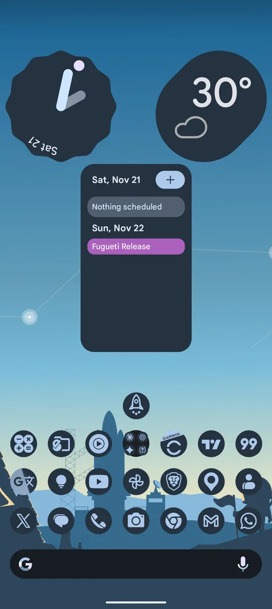
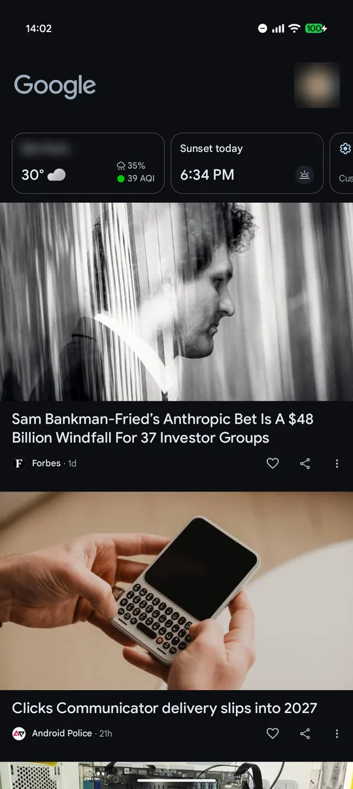

# Fugueti

Fugueti is an Android home app (launcher) based on
[Lawnchair](https://github.com/LawnchairLauncher/lawnchair) and AOSP Launcher3, with 13
configurable home screen gestures, the Google feed without third party bridges, and backups that
bring everything back.

  
  &nbsp;
  

| Project | What it is | Download |
|---|---|---|
| [**Fugueti Launcher**](https://github.com/victorwalter/fugueti-launcher) | The launcher. Stable line on Android 16, nightly on Android 17. | [Latest release](https://github.com/victorwalter/fugueti-launcher/releases/latest) |
| [**Fugueti Feed**](https://github.com/fugueti/feed) | Small companion app that connects the Google feed (Discover) to Fugueti. | [Latest release](https://github.com/fugueti/feed/releases/latest) |

**Links:** [fugueti.app](https://fugueti.app) · [X @fuguetiapp](https://x.com/fuguetiapp) ·
[hello@fugueti.app](mailto:hello@fugueti.app)

Found a bug or have an idea? Open an issue in the project's repository. Security problems: please
report them privately, see [SECURITY.md](https://github.com/fugueti/.github/blob/main/SECURITY.md).

Fugueti is free and open source (GPL-3.0-or-later). If you want to support it, there are donation
options at [fugueti.app](https://fugueti.app).
